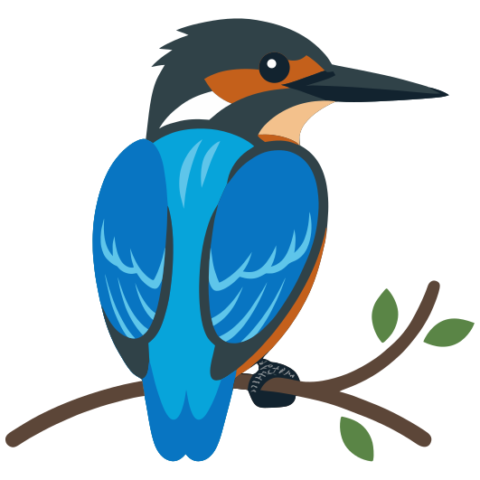
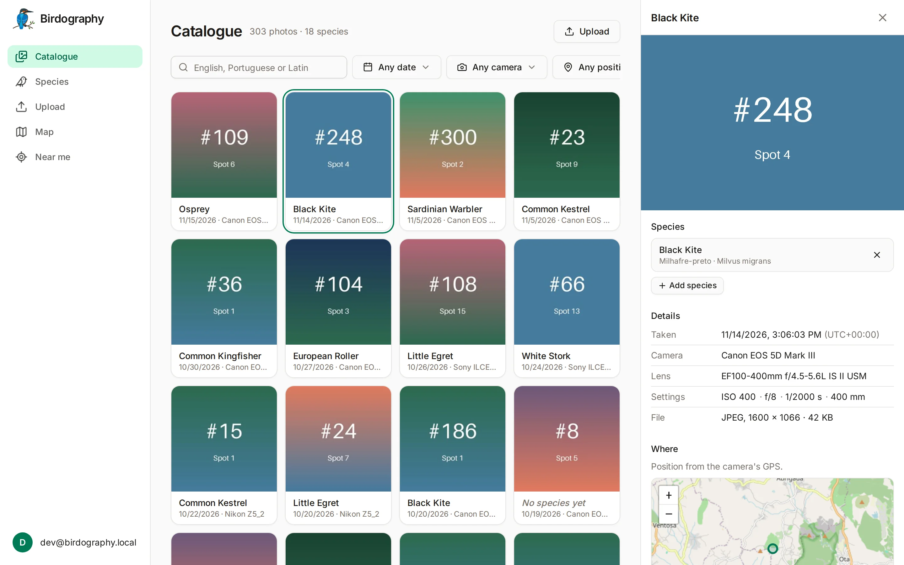
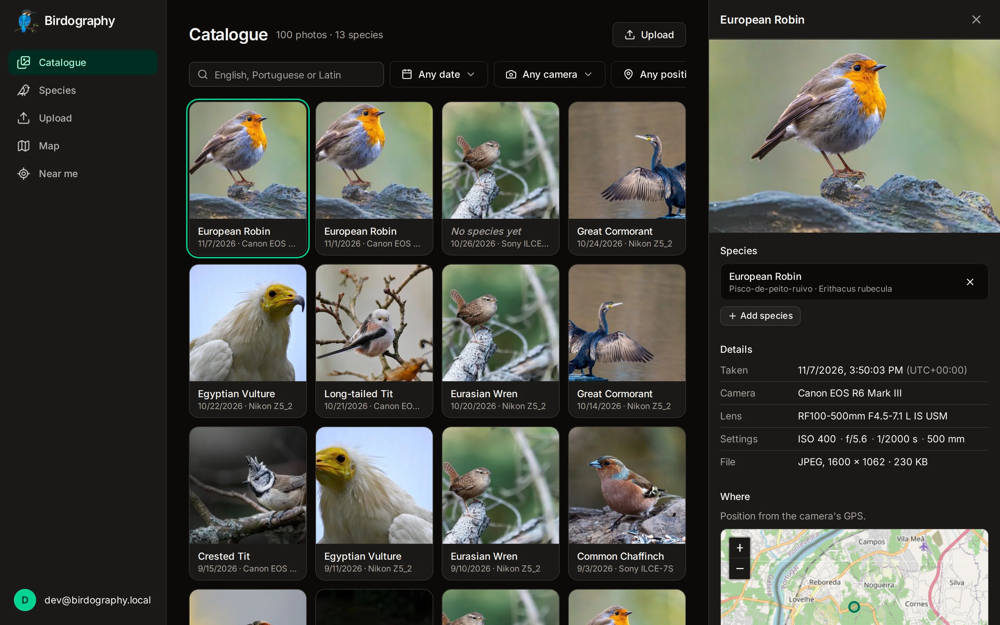
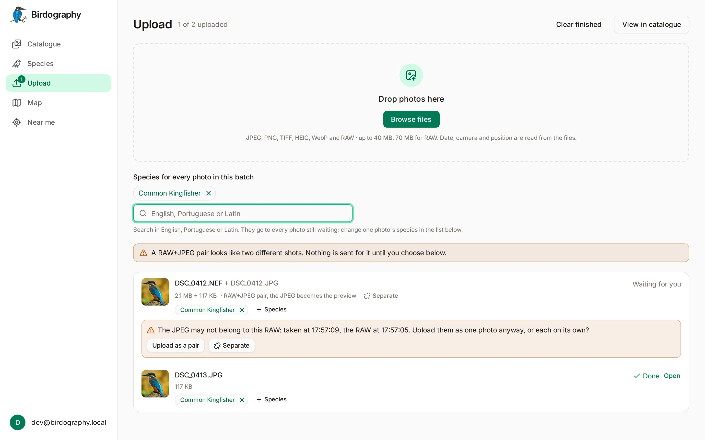
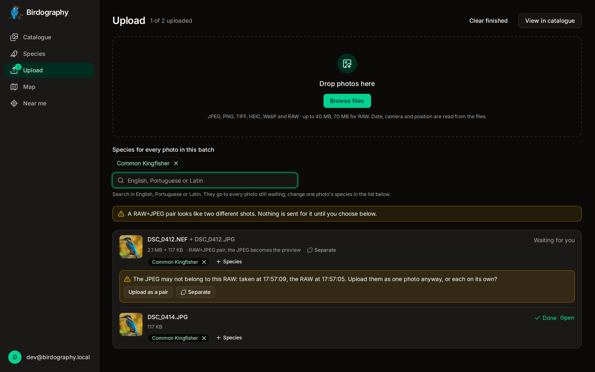
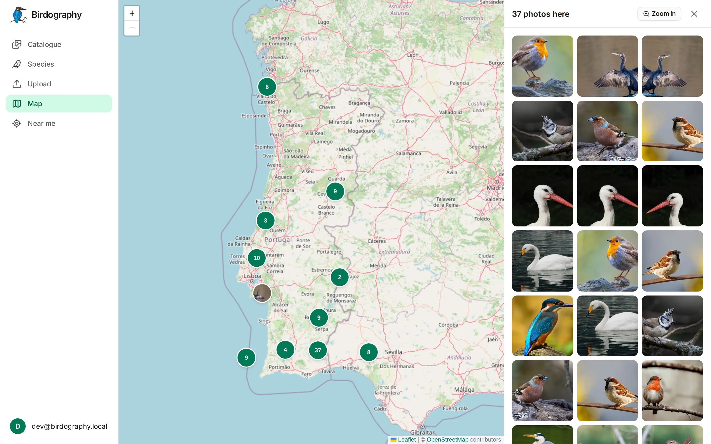
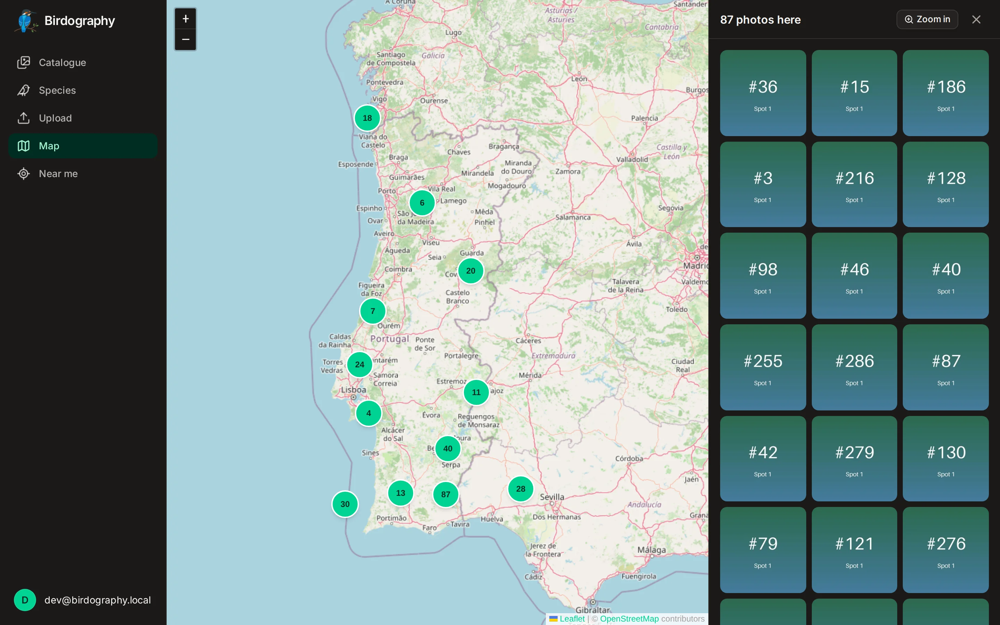
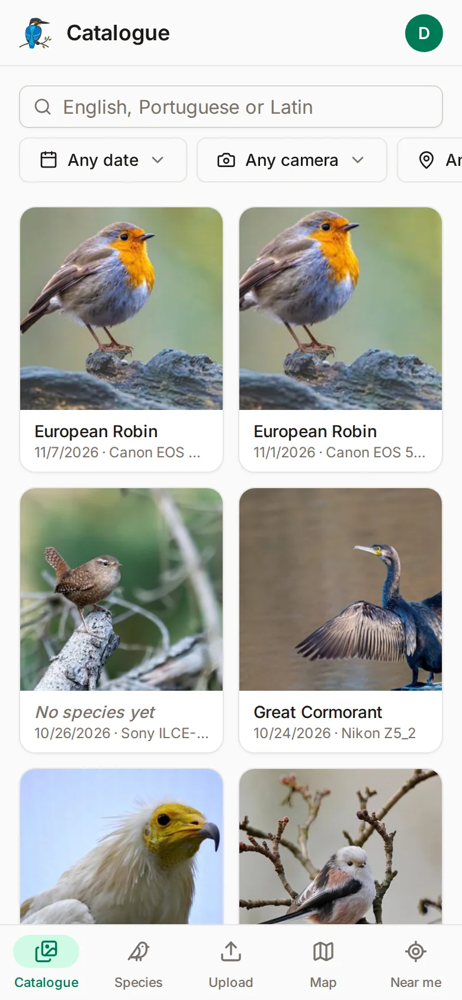
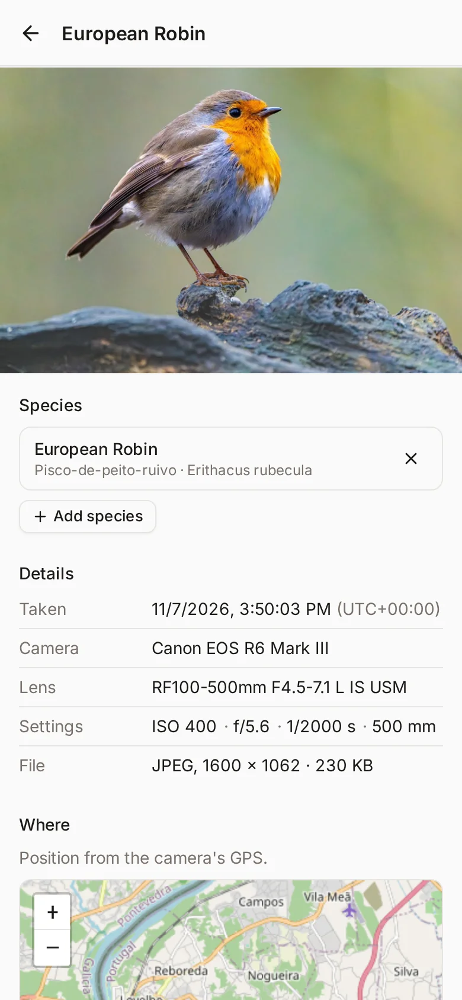
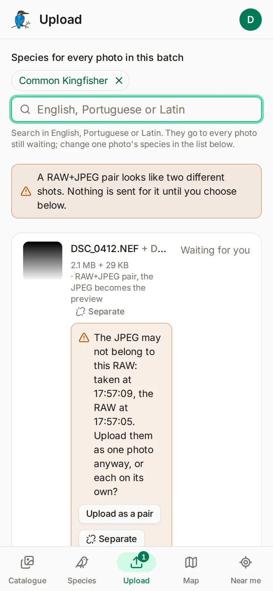

<p align="center">
  
</p>

<h1 align="center">Birdography</h1>

<p align="center">
  A self-hosted catalogue for your bird photography: your photos, the species in them, and the places you took them.
</p>

<p align="center">
  <a href="https://github.com/MatiasN/Birdography/actions/workflows/ci.yml"></a>
  <a href="LICENSE"></a>
</p>

Birdography runs on your own machine or server with Docker. It reads the date, camera settings and GPS position
from your files (JPEG, HEIC and the RAW formats of the main camera brands), keeps the species you tag in English,
Portuguese and Latin, and puts every photo on a map. It is meant to sit next to tools like eBird and Merlin, not to
replace them: you own the photos, and the next phases add what you still need to photograph and what is likely
around you.

## A tour

**Catalogue.** Every photo, newest first, with its species, date and camera. Filter by species (search in any of
the three languages), by the day it was taken, by camera brand or model, and by whether it has a position. The
filters live in the address bar, so Back undoes a change and a link keeps them. Open a photo and its details sit
beside the grid on a wide screen, or fill the screen on a phone: species, when it was taken (with its time zone),
camera, lens and settings, the file, and a small map to place a photo the camera couldn't.

<p align="center">
  
  
</p>

**Upload.** Drop photos on the page or pick them from your phone. Each file shows its progress; two go at a time.
Pick the species for the whole batch, or for one photo, while they upload, and add a species that isn't in the
list yet on the spot. A RAW and its camera JPEG with the same name go up as one photo, the JPEG becoming the
preview; before they are sent, Birdography reads both files in the browser and, when their date or camera don't
match, asks whether they really are the same shot. Files already in your catalogue are recognised and not stored
twice.

<p align="center">
  
  
</p>

**Map.** Every located photo at once. Photos close together join into one marker with a count; click it to see
them, or zoom in to split it. A photo opened from the map keeps the map beside it.

<p align="center">
  
  
</p>

**Every species, in your language.** The species list is the eBird taxonomy, over 11,000 species with their
English, Portuguese and scientific names, loaded with one command. The search finds a species by any of the three,
puts the ones you have photographed first, and the profile page sets which name comes first everywhere. A species
you added by hand and later recognise can be merged into the real one, photos and all.

**On any screen, in your theme.** A sidebar on desktop, a bottom tab bar on phones, with large touch targets.
Light, dark, or whatever your system uses, chosen on the profile page.

The Species and Near me tabs are placeholders for Phase 2 (see [What's next](#whats-next)).

## On mobile

The same app on a phone: the tabs move to a bottom bar, pages become one column, and a photo's details or the
upload queue fill the screen. Built for the field, where you pick the species of what you just shot and see what
is around you on the map.

<p align="center">
  
  
  
</p>

## Concepts

- **Photos and files.** A photo is one shot. It has an original file, a browser-viewable preview when the original
  isn't one (RAW, HEIC, TIFF) and a thumbnail. Previews and thumbnails carry no metadata, so a GPS position never
  leaves with them. Uploads are limited to 40 MB per photo and 70 MB for RAW, both configurable. The same file is
  never stored twice.
- **RAW+JPEG pairs.** Cameras that write both give two files with one name (`DSC_0412.NEF` and `DSC_0412.JPG`).
  Uploaded together they make one photo: the RAW is the original, the camera's JPEG the preview.
- **Species.** One shared list, each species with its scientific name and its English and Portuguese names (one of
  the two at least). A photo can show several species. Search matches any of the names, ignoring case and accents.
  The fields for the eBird taxonomy are there for Phase 2 to fill.
- **Where and when.** The position comes from the camera's GPS, or you pick it on the map in the photo's details.
  The time zone comes from the camera when it records one, otherwise from the position, so "08:42" means the
  local time the photo was taken. The API also takes a corrected date for a photo whose camera clock was wrong;
  the UI for it comes later.
- **Trash.** Deleted photos, species and locations stay in a trash for 30 days before they are purged, and can be
  restored meanwhile with `python -m app.cli restore`. Deleting is through the API or the command line for now;
  the UI for it comes later.

## Quick start

You need Docker with Compose. Clone, set two secrets, start, create your login:

```bash
git clone https://github.com/MatiasN/Birdography.git
cd Birdography
cp .env.example .env    # set POSTGRES_PASSWORD and SECRET_KEY, see below
docker compose -f docker-compose.yml up -d --build
docker compose exec backend python -m app.cli create-user you@example.com
docker compose exec backend python -m app.cli import-taxonomy   # the eBird species list; needs internet
```

Generate `POSTGRES_PASSWORD` and `SECRET_KEY` with `python -c "import secrets; print(secrets.token_urlsafe(32))"`;
the backend does not start with the placeholders. Database migrations run when the backend starts.

Open http://localhost:3000, or `http://<this machine's address>:3000` from a phone on the same network, and log
in. Only the web UI is published; the API is behind it at `/api/` and the database is not reachable from outside.
Set `BIND_ADDRESS=127.0.0.1` to keep the UI to this machine. To serve it over HTTPS, put a reverse proxy in front
and set `SECURE_COOKIES=true` and `TRUSTED_PROXIES`.

**Where your data is.** Photos are in `./data/photos` (`UPLOAD_DIR`) and the database in the `db-data` volume.
Back both up with `scripts/backup.sh` and bring them back with `scripts/restore.sh`.

**Updating.** `git pull`, then the same `docker compose … up -d --build`; migrations apply on start.

**Settings.** Upload limits, session length, registration, the request limit of the web server and more are
environment variables in `.env`, listed in [CONTRIBUTING.md → Settings](CONTRIBUTING.md#settings).

## Stack

| Layer    | Tech                                                |
|----------|-----------------------------------------------------|
| Backend  | Python, FastAPI, SQLAlchemy, Alembic                |
| Database | PostgreSQL + PostGIS                                |
| Frontend | React, TypeScript, Vite, Tailwind CSS, shadcn/ui    |
| Maps     | Leaflet, supercluster, OpenStreetMap tiles          |
| Images   | ExifTool, Pillow, pillow-heif                       |
| Deploy   | Docker Compose, nginx                               |

## Development

`scripts/dev.sh up` starts a disposable local stack with a dev login and 100 photos of real birds around Portugal,
apart from any real install; see [Dev stack](CONTRIBUTING.md#dev-stack). [CONTRIBUTING.md](CONTRIBUTING.md) also
covers running the backend and frontend by hand, the API, migrations, tests (100% coverage on both sides) and the
design decisions behind each part, written up in [docs/plans](docs/plans). The screenshots above come from the dev
stack: `scripts/screenshots.sh` retakes them. Species names and taxonomy come from
[eBird](https://ebird.org) (Cornell Lab of Ornithology), downloaded by each install and not redistributed here. The bird photos in the dev stack and the screenshots are from Pixabay; the photographers
are credited in [backend/devtools/samples/CREDITS.md](backend/devtools/samples/CREDITS.md).

## What's next

Phase 2 turns the catalogue into a field guide: after the built-in eBird species list, regions for every photo, photos grouped into the places you stop at, a page per species, and the **Near me** tab with the species
likely around you. Phase 3 tracks the gaps: the species of a region you haven't photographed yet, your life list,
stats. The full plan, with what is done, is in [ROADMAP.md](ROADMAP.md). Ideas and feedback are welcome in
[issues](https://github.com/MatiasN/Birdography/issues).

## Contributing

Issues and pull requests are welcome. See [CONTRIBUTING.md](CONTRIBUTING.md).

## Credits

- Map tiles and the time zone boundaries are built from [OpenStreetMap](https://www.openstreetmap.org/copyright)
  data, © OpenStreetMap contributors, licensed under the [ODbL](https://opendatacommons.org/licenses/odbl/).
- Time zones from positions: [tzfpy](https://github.com/ringsaturn/tzfpy) (MIT), whose zone boundaries come from
  [timezone-boundary-builder](https://github.com/evansiroky/timezone-boundary-builder).
- Metadata: [ExifTool](https://exiftool.org/) by Phil Harvey.
- RAW test fixtures: camera samples from [raw.pixls.us](https://raw.pixls.us/), dedicated to the public domain under
  [CC0 1.0](https://creativecommons.org/publicdomain/zero/1.0/). Contributors are listed on each sample's page; the
  files used are in [backend/tests/fixtures/raw](backend/tests/fixtures/raw/README.md).
- Icons: [Lucide](https://lucide.dev/) (ISC). Typeface: [Inter](https://rsms.me/inter/) (OFL).

## License

[MIT](LICENSE)
